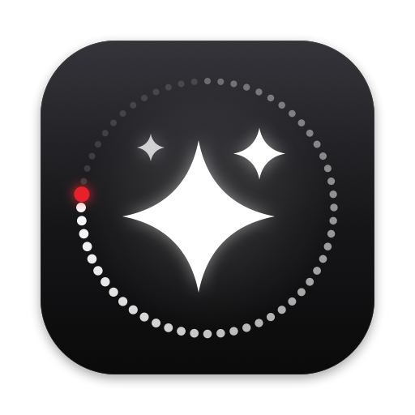
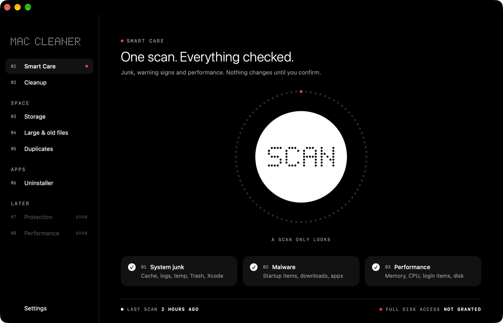
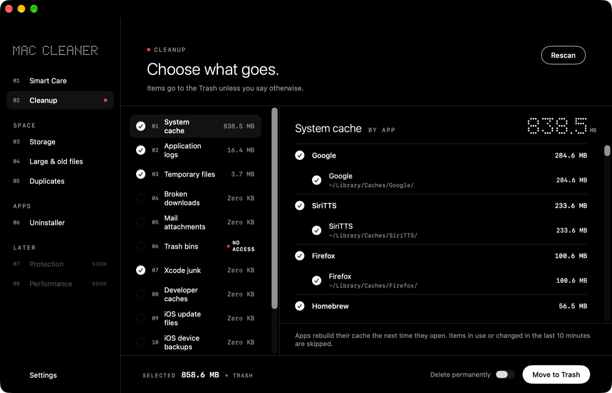
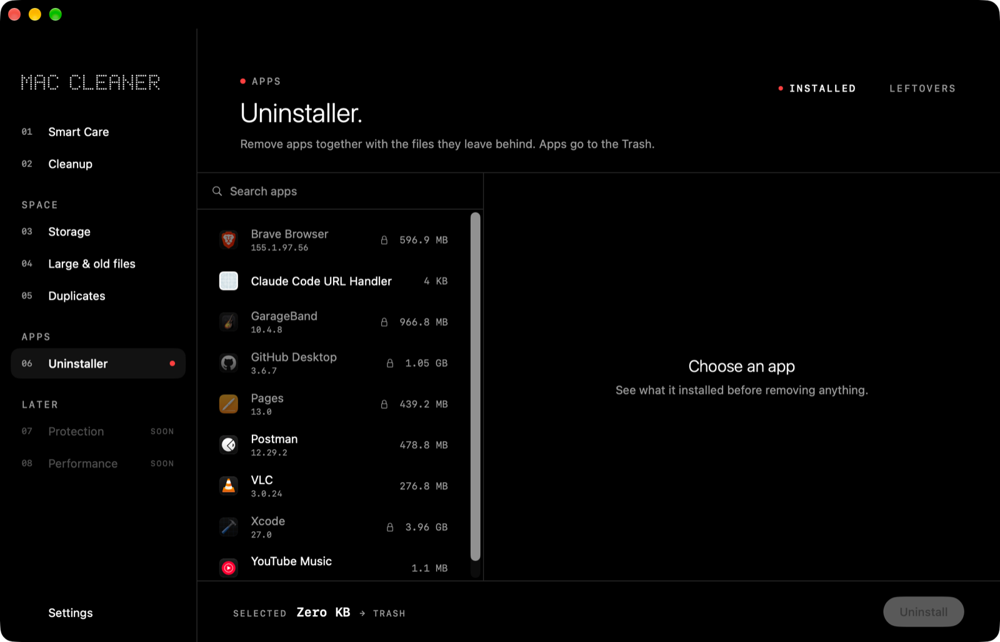
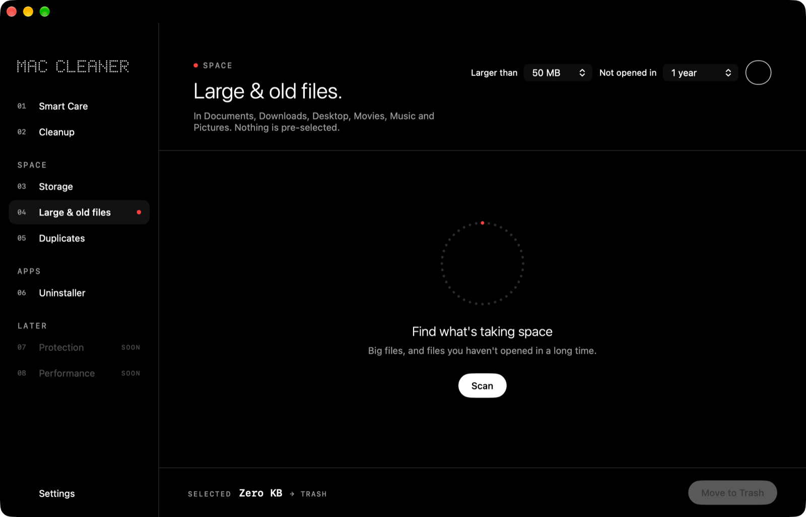
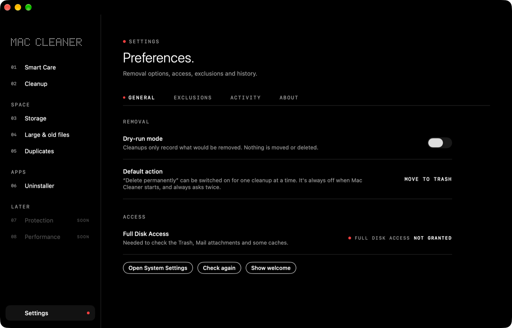
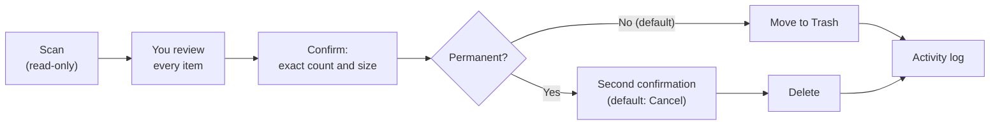
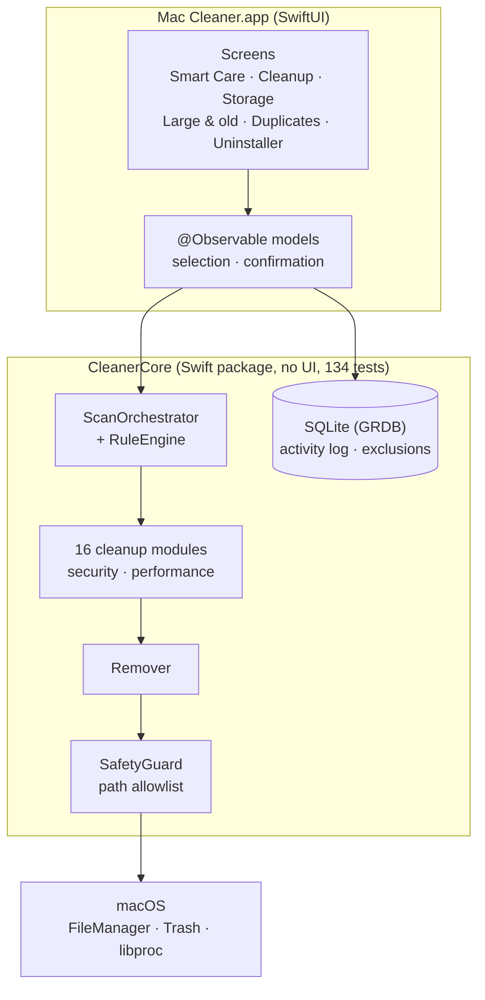

<p align="center">
  <picture>
    <source media="(prefers-color-scheme: dark)" srcset="docs/images/banner-dark.svg">
    
  </picture>
</p>

<p align="center">
  
  <b>A free, open-source Mac cleaner that never removes anything without asking you first.</b><br>
  Created by <a href="https://github.com/ravishan123">Ravishan Lakshitha</a>
</p>

<p align="center">
  <a href="https://github.com/ravishan123/MacCleanerX/releases/latest"></a>
  <a href="https://github.com/ravishan123/MacCleanerX/actions/workflows/ci.yml"></a>
  
  
  <a href="LICENSE"></a>
</p>

<p align="center">
  <a href="https://github.com/ravishan123/MacCleanerX/releases/latest"><b>⬇ Download for Mac</b></a> ·
  <a href="https://ravishan123.github.io/MacCleanerX/">Website</a> ·
  <a href="docs/USER_GUIDE.md">User guide</a> ·
  <a href="docs/ARCHITECTURE.md">Architecture</a>
</p>

Mac Cleaner finds junk, shows where your disk space goes, removes apps with their leftovers, and checks startup items for warning signs. **It never removes anything without asking you first.**

> [!WARNING]
> **Use at your own risk.** Mac Cleaner only touches your own files, moves items to the Trash by default and asks before every cleanup, but no cleaner can guarantee that removing a file is harmless. Keep a backup (for example with Time Machine). The malware check looks for common warning signs; it is **not antivirus software** and cannot promise your Mac is free of malware.

## Screenshots

See what Mac Cleaner looks like before you install it. These are real screens from the app, with no mock-ups.

<p align="center">
  
</p>

| Cleanup | Uninstaller |
|---|---|
|  |  |
| **Choose what goes.** Twelve categories, grouped by app, with exact sizes. Items go to the Trash. | **Remove apps completely.** See every file an app installed before removing anything. |
|  |  |
| **Large & old files.** Pick a size and how long since you opened them. Nothing is pre-selected. | **Settings.** Dry-run mode, Trash by default, exclusions and an activity log. |

## Download

**[⬇ Download the latest version](https://github.com/ravishan123/MacCleanerX/releases/latest)**: get `MacCleaner-<version>.dmg`, open it and drag **Mac Cleaner** to **Applications**.

Mac Cleaner is free and not notarized by Apple (that needs a paid developer account), so the first time you open it macOS blocks it. **[Follow these four steps once](docs/USER_GUIDE.md#first-launch-open-anyway)** to allow it. Then **[give it Full Disk Access](docs/USER_GUIDE.md#full-disk-access)** so it can check every folder.

Requires macOS 14 Sonoma or later, on Apple silicon or Intel.

## Features

| | |
|---|---|
| **Smart Care** | One Scan button checks junk, startup items and performance at the same time, then recommends what to do, labeled **Safe** or **Review**. |
| **Cleanup** | Twelve categories: system cache, app logs and crash reports, temporary files, broken downloads, Mail attachments, Trash, Xcode junk, developer caches (npm, Gradle, Cargo…), iOS update files, iPhone/iPad backups, old installers and broken startup items. |
| **Storage** | See what fills your disk (documents, images, videos, audio, archives, apps, developer files, caches, backups, Mail) and the largest items in each. |
| **Large & old files** | Big files, and files you haven't opened in months, in your personal folders. |
| **Duplicates** | Exact copies, confirmed byte for byte. One copy always stays. |
| **Uninstaller** | Remove an app together with the files it left in `~/Library`, and find leftovers of apps you deleted long ago. |
| **Startup check** | Flags startup items that are hidden, run from temporary folders, download code, or have broken signatures. Checks app signatures and Gatekeeper status. |
| **Performance** | Memory pressure, apps using a lot of CPU, how many items start at login, and free disk space. |

Also: dry-run mode, an activity log of everything moved or deleted, an exclusion list, dark mode, VoiceOver and full keyboard navigation.

## How it keeps your files safe



- **Scans never change anything.** Tests compare every file before and after each scan.
- **A hard allowlist.** Every path is resolved with `realpath` and must be inside a known cleanable folder. System folders, your home folder itself, symlinks that point elsewhere and SIP-protected files are always refused, and every item is checked again right before it's removed.
- **Trash first.** Permanent deletion is off by default, resets on every launch and asks twice.
- **Busy files are skipped.** Anything open in an app or changed in the last 10 minutes is left alone.
- **Honest numbers.** Sizes count the space you'd actually get back (APFS clones and hard links included).

Read the full **[safety design](docs/SAFETY.md)**.

## How it's built



All file-system logic lives in `CleanerCore`; the app is only UI. Every removal goes through one path (`Remover` → `SafetyGuard`). The **[architecture document](docs/ARCHITECTURE.md)** has use-case, component, sequence, class, state, database and deployment diagrams, and **[docs/DIAGRAMS.md](docs/DIAGRAMS.md)** lists every diagram in the project.

## Documentation

| For users | For developers |
|---|---|
| [User guide](docs/USER_GUIDE.md): install, first launch, every screen, FAQ | [Development guide](docs/DEVELOPMENT.md): build, test, add a cleanup module |
| [Safety design](docs/SAFETY.md): what is and isn't touched | [Architecture](docs/ARCHITECTURE.md): diagrams of every layer |
| [Changelog](CHANGELOG.md) | [Releasing](docs/RELEASING.md): build the `.dmg` and publish |
| [Security policy](SECURITY.md) | [Contributing](CONTRIBUTING.md) · [Code of conduct](CODE_OF_CONDUCT.md) |
| [Authors and credits](AUTHORS.md) | [All diagrams](docs/DIAGRAMS.md) |

## Build from source

```sh
brew install xcodegen
git clone https://github.com/ravishan123/MacCleanerX.git
cd MacCleanerX
xcodegen generate
open MacCleaner.xcodeproj           # press ⌘R

swift test --package-path Packages/CleanerCore   # 134 tests, fixtures only
scripts/make-dmg.sh 1.0.0                        # → build/MacCleaner-1.0.0.dmg
```

Details in the [development guide](docs/DEVELOPMENT.md).

## Not included on purpose

- **Removing language files or "thinning" apps:** breaks app code signatures.
- **Cleaning inside the Photos library or Messages:** corrupts them.
- **RAM "boosters", maintenance scripts, system-wide cleaning:** need administrator rights and do little on modern macOS.
- **File shredding:** not reliable on SSDs.

## Contributing

Bug reports, ideas and pull requests are welcome. Start with [CONTRIBUTING.md](CONTRIBUTING.md). Found a way Mac Cleaner could remove something it shouldn't? Please follow the [security policy](SECURITY.md) instead of opening a public issue.

## Author

<a href="https://github.com/ravishan123"></a>

**Ravishan Lakshitha** ([@ravishan123](https://github.com/ravishan123)): creator and maintainer. Designed and built Mac Cleaner, from the safety design and the cleaning engine to the app, its icon and these docs.

<br clear="left">

If Mac Cleaner helped you, please ⭐ **star the repo**; it helps other people find it. Full credits, contributors and third-party software are in [AUTHORS.md](AUTHORS.md).

## License

[MIT](LICENSE) © 2026 Ravishan Lakshitha and Mac Cleaner contributors. Uses [GRDB.swift](https://github.com/groue/GRDB.swift) (MIT).
