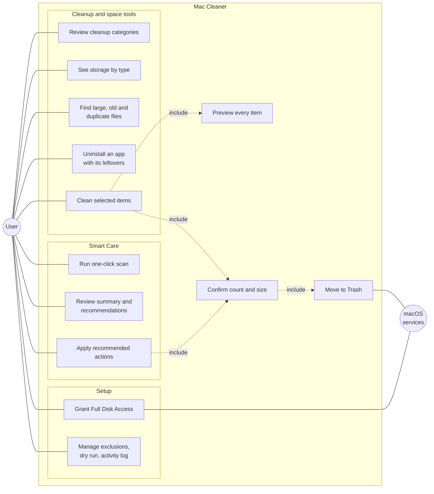
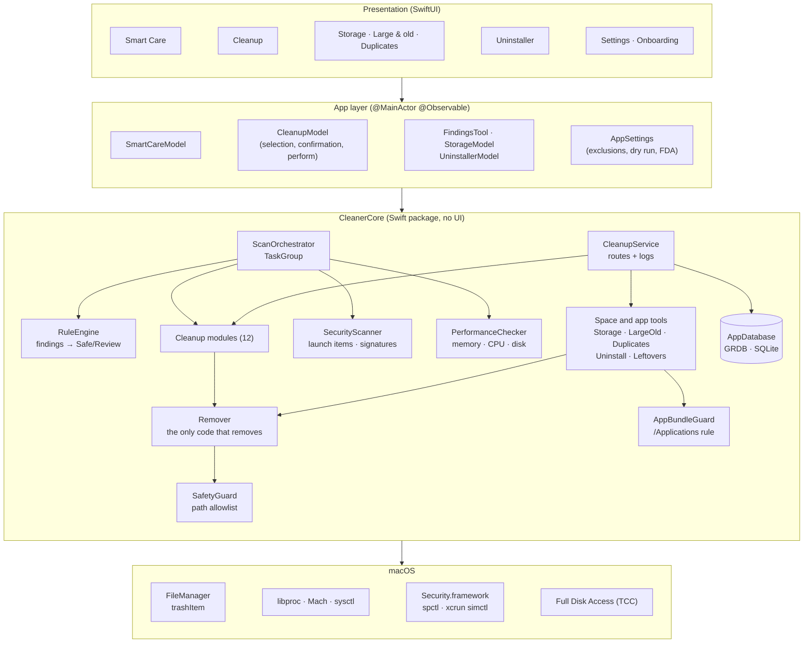
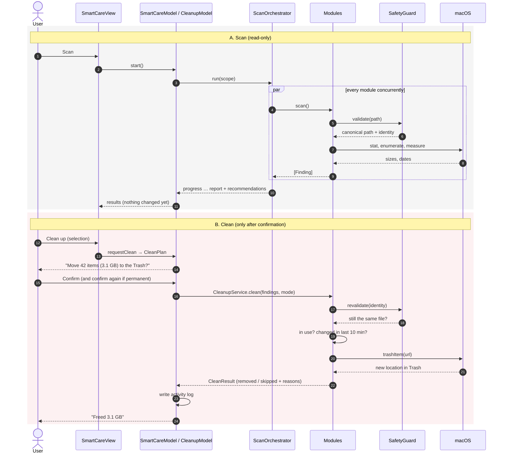
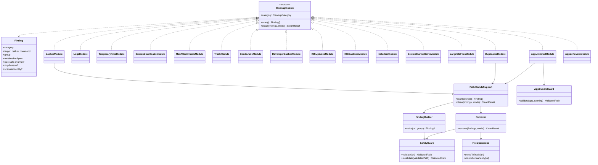
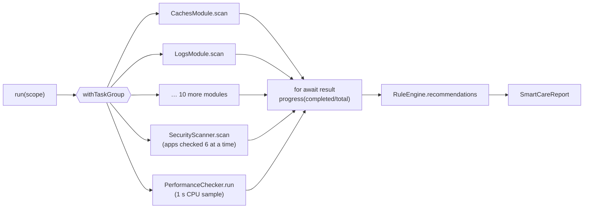
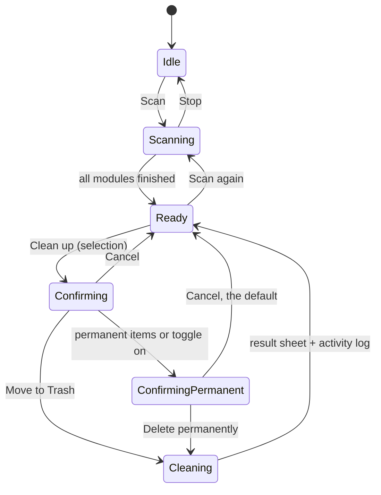
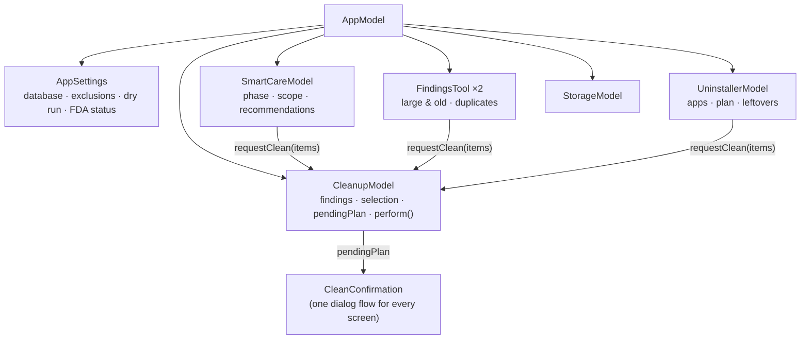
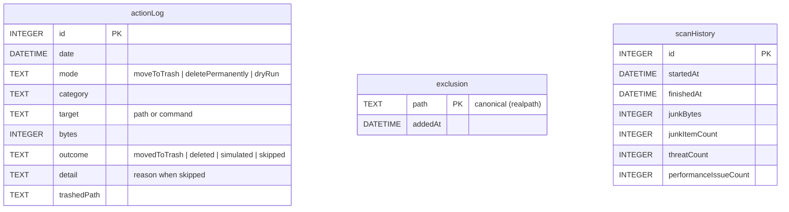
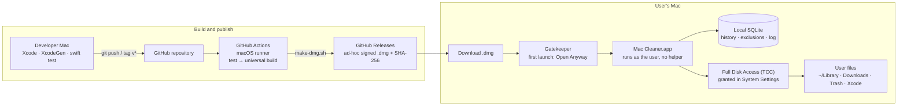

# Architecture

Mac Cleaner has two parts:

- **`App/MacCleaner`**: the SwiftUI app. Screens, view models, design system. No file-system logic.
- **`Packages/CleanerCore`**: a Swift package with all scanning, measuring, cleaning, safety and storage code. It never imports SwiftUI or AppKit, so it is fully unit-testable.

Contents:
1. [Use cases](#1-use-cases)
2. [System architecture](#2-system-architecture)
3. [Scan, then clean (sequence)](#3-scan-then-clean)
4. [Cleanup modules](#4-cleanup-modules)
5. [Smart Care concurrency](#5-smart-care-concurrency)
6. [App state](#6-app-state)
7. [Database](#7-database)
8. [Build and deployment](#8-build-and-deployment)
9. [Source map](#9-source-map)

The safety rules have their own document: [SAFETY.md](SAFETY.md).

---

## 1. Use cases



---

## 2. System architecture



**Rules between layers**
- Views never call `FileManager`. They go through a model, which goes through `CleanerCore`.
- Every removal goes `CleanupModel.perform` → `CleanupService` → module `clean` → `Remover` (or `AppBundleGuard` for `.app` bundles) → `FileOperations`.
- Anything with side effects (file operations, commands, clock, open-file snapshot) is injected through `ModuleContext`, so tests can swap in fakes.

---

## 3. Scan, then clean



---

## 4. Cleanup modules

Every cleaner implements one protocol. Path-based modules share `PathModuleSupport`, so they all follow the same scan and removal rules.



| Category | Module | Looks in | Risk |
|---|---|---|---|
| System cache | `CachesModule` | `~/Library/Caches/*` | Safe |
| Application logs | `LogsModule` | `~/Library/Logs`, `DiagnosticReports/*` | Safe |
| Temporary files | `TemporaryFilesModule` | `$TMPDIR/*` | Safe |
| Broken downloads | `BrokenDownloadsModule` | `~/Downloads/**/*.crdownload, .download, .part` | Safe |
| Mail attachments | `MailAttachmentsModule` | Mail's `Mail Downloads` | Review |
| Trash | `TrashModule` | `~/.Trash/*` (permanent only) | Review |
| Xcode junk | `XcodeJunkModule` | DerivedData, DeviceSupport, simulator caches, Archives, `simctl delete unavailable` | Safe / Review |
| Developer caches | `DeveloperCachesModule` | `~/.npm/_cacache`, `~/.gradle/caches`, … | Safe / Review |
| iOS update files | `IOSUpdatesModule` | `~/Library/iTunes/* Software Updates/*.ipsw` | Safe |
| iOS backups | `IOSBackupsModule` | `MobileSync/Backup/*` | Review |
| Old installers | `InstallersModule` | `~/Downloads/*.dmg, .pkg` older than 7 days | Review |
| Broken startup items | `BrokenStartupItemsModule` | `~/Library/LaunchAgents/*.plist` with missing program | Review |
| Large & old files | `LargeOldFilesModule` | Documents, Downloads, Desktop, Movies, Music, Pictures | Review |
| Duplicates | `DuplicatesModule` | same personal folders | Review |
| Applications | `AppUninstallModule` | `.app` bundles + `~/Library` leftovers | Review / Safe |
| Leftovers | `AppLeftoversModule` | `~/Library/*/<bundle id>` of uninstalled apps | Review |

---

## 5. Smart Care concurrency



- Child tasks run off the main actor. Progress is sent back to the `@MainActor` model.
- Cancelling the scan task stops long walks: `SizeCalculator` and the storage scanner check `Task.isCancelled`.
- External tools (`spctl`, `xcrun`) have a 30-second timeout and come from a fixed allowlist in `CommandRunner`.

---

## 6. App state



Models (`App/MacCleaner/Model`):



---

## 7. Database

Stored at `~/Library/Application Support/Mac Cleaner/MacCleaner.sqlite` (GRDB, migration `v1`).



The tables are independent. Exclusions are read into `ModuleContext.exclusions` before each scan and checked again before each removal.

---

## 8. Build and deployment



- **No sandbox, no privileged helper.** Mac Cleaner can only do what your user account can do.
- **Ad-hoc signature.** Each build has a new signature, so macOS may ask for Full Disk Access again after an update.
- **Updates:** download the new `.dmg` from Releases. Automatic updates (Sparkle) could come later.

---

## 9. Source map

```
App/MacCleaner/
  MacCleanerApp.swift        App entry, window, menu commands
  Sidebar/                   RootView (shell + confirmation), NavigationModel
  Model/                     AppModel, AppSettings, CleanupModel, SmartCareModel, ToolModels, CleanOutcome
  SmartCare/  Cleanup/  Space/  Apps/  Settings/  Onboarding/   Screens
  Shared/                    CleanConfirmation (alerts + result sheet), ToolList
  Design/                    Theme tokens, DotMatrix font, components
Packages/CleanerCore/Sources/CleanerCore/
  Safety/SafetyGuard.swift   Path allowlist
  FileSystem/                SizeCalculator, Remover, FileOperations, OpenFileSnapshot
  Modules/                   CleanupModule, PathModuleSupport, FindingBuilder, 12 junk modules, CleanupService, ModuleRegistry
  Space/                     StorageScanner, LargeOldFilesModule, DuplicatesModule, PersonalFolders
  Apps/                      AppInventory, AppBundleGuard, AppUninstallModule, AppLeftoversModule
  SmartCare/                 ScanOrchestrator, RuleEngine
  Security/                  LaunchItems, SignatureChecker, SecurityScanner
  Performance/               PerformanceChecker, PerformanceRules
  Store/                     AppDatabase, Records
  Model/                     Finding, CleanResult, CleanPlan
  Support/                   ModuleContext, CommandRunner, FullDiskAccess, AppNameResolver
Packages/CleanerCore/Tests/CleanerCoreTests/   131 Swift Testing tests (fixtures in $TMPDIR)
```
