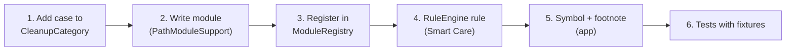

# Development guide

## Requirements

| Tool | Version | Why |
|---|---|---|
| macOS | 14 or later | Deployment target |
| Xcode | 16 or later (Swift 6) | Build and test |
| [XcodeGen](https://github.com/yonaskolb/XcodeGen) | 2.40+ | Generates `MacCleaner.xcodeproj` from `project.yml` |

```sh
brew install xcodegen
```

Swift packages are fetched automatically: [GRDB.swift](https://github.com/groue/GRDB.swift) 7.x, pinned in `Packages/CleanerCore/Package.resolved`.

## Build and run

```sh
git clone https://github.com/ravishan123/MacCleaner.git
cd MacCleaner
xcodegen generate              # re-run after adding or removing files
open MacCleaner.xcodeproj      # scheme "MacCleaner", destination "My Mac", ⌘R
```

Command line:

```sh
xcodebuild -project MacCleaner.xcodeproj -scheme MacCleaner -derivedDataPath build/DerivedData build
open "build/DerivedData/Build/Products/Debug/Mac Cleaner.app"
```

`MacCleaner.xcodeproj` and `build/` are git-ignored. `project.yml` is the source of truth for build settings.

## Test

```sh
swift test --package-path Packages/CleanerCore
# or in Xcode: ⌘U
```

All logic lives in `CleanerCore`, and every module is tested there with **Swift Testing**.

### Test rules (please keep them)

1. **Never touch real user folders.** Use `Fixture` (`Tests/CleanerCoreTests/Support/Fixture.swift`). It creates a unique folder under `$TMPDIR` and deletes only that folder when the test ends.
2. **Use `fx.context()`** for a `ModuleContext` whose home, temporary folder, **Trash** and command runner are all fakes inside the fixture. `ModuleContext` has no default file operations, so forgetting this is a compile error, not a trip to your real Trash.
3. **Prove scans are read-only:** compare `fx.treeSnapshot()` before and after.
4. **Test refusal, not just success:** forged findings outside the allowlist, symlink escapes, items swapped after the scan.
5. **Mutation check new safety rules:** temporarily disable the rule and confirm at least one test fails.

Fixture helpers: `file(_:bytes:)`, `dir(_:)`, `symlink(_:to:)`, `exists(_:)`, `setModificationDate(_:_:)`, `treeSnapshot()`, plus `OperationLog` (records fake Trash and delete calls) and `FakeCommands` (canned `xcrun`/`spctl` output).

## Project layout

```
project.yml                      XcodeGen spec (targets, settings, signing)
App/MacCleaner/                  SwiftUI app (no file-system logic)
Packages/CleanerCore/            Swift package: everything else
  Sources/CleanerCore/
  Tests/CleanerCoreTests/
scripts/make-dmg.sh              Universal build + .dmg + checksum
.github/workflows/               CI and release
docs/                            These documents
```

See [ARCHITECTURE.md](ARCHITECTURE.md) for diagrams and the full source map.

## Adding a cleanup category

Example: a module that offers `~/Library/Caches`-style folders for a fictional tool.



**1. Category.** In `Model/Finding.swift`, add a case to `CleanupCategory`, give it a `displayName`, and add it to `junkCases` if it belongs on the Cleanup screen.

**2. Module.**

```swift
public struct ExampleCacheModule: CleanupModule {
    public let category = CleanupCategory.exampleCache
    private let support: PathModuleSupport
    private let root: URL

    public init(context: ModuleContext) {
        root = context.home.appending(path: ".example/cache", directoryHint: .isDirectory)
        // The guard may only clean *inside* these roots, never the roots themselves.
        support = PathModuleSupport(category: category, context: context, roots: [root])
    }

    public func scan() async -> [Finding] {          // read-only
        await support.scan([
            .topLevel(root, risk: .safe, accessGroup: "Example", group: { _ in "Example" }),
        ])
    }

    public func clean(_ findings: [Finding], mode: RemovalMode) async -> CleanResult {
        support.clean(findings, mode: mode)          // Remover + SafetyGuard
    }
}
```

Rules:
- **Never call `FileManager.removeItem` or `trashItem` yourself.** Use `support.clean`, which goes through `Remover`.
- **Keep roots as tight as possible,** and always inside the home folder.
- Use **`.review`** for anything that might hold the user's own data.

**3. Register** it in `ModuleRegistry.standard` (`Modules/CleanupService.swift`).

**4. Smart Care:** add a `CleanRule` in `SmartCare/RuleEngine.swift`.

**5. App:** add a `symbol` and `footnote` in `App/MacCleaner/Design/Components.swift`.

**6. Tests:** add a test to `CleanupModulesTests.swift` or a new file. At minimum: it lists the right items, ignores the wrong ones, its scan changes nothing, and it refuses a forged finding outside its root.

## Design system

The UI uses a small monochrome design system called "Mono" (`App/MacCleaner/Design`):

| Token / component | Use |
|---|---|
| `Theme.background / surface / hairline / primary / secondary` | White/black surfaces, black/white text, thin dividers |
| `Theme.accent` (red) | **Only** as a signal: active item, Review, warnings, permanent deletion |
| `Typo.mono(size, weight)` | Uppercase labels, sizes, numbers |
| `DotMatrixText` | Big numbers and short words (original 5×7 dot font) |
| `DotRing` | Scan progress and placeholders |
| `PillButtonStyle` (`.pillPrimary`, `.pill`, `.pillDestructive`, `.pillSmall`) | Buttons |
| `CheckButton` / `CheckToggle` | Round checkboxes (with VoiceOver traits) |
| `Tag` | `SAFE`, `REVIEW` (red dot), `IN USE`, `PERMANENT` |

Accessibility checklist for new UI: every control needs a VoiceOver label; Safe/Review must never be shown by colour alone; text in `Theme.secondary` meets 4.5:1 contrast; everything must be reachable with Tab; respect Reduce Motion.

## Code style

- Swift 6 language mode with strict concurrency. Models are `@MainActor @Observable`; core types are `Sendable`.
- Use typed throws (`throws(SafetyGuard.Rejection)`) for guards.
- No force-unwraps in core code paths that touch files.
- Write user-facing text in plain, honest language: "No known threats found", never "Your Mac is safe".

## Debugging tips

- **Logs:** `log stream --predicate 'process == "Mac Cleaner"'`
- **App data:** `~/Library/Application Support/Mac Cleaner/MacCleaner.sqlite` (open with `sqlite3`)
- **Reset onboarding:** `defaults delete io.github.maccleaner.app onboardingCompleted`
- **Full Disk Access:** each debug build has a new ad-hoc signature. If macOS stops granting access, toggle the app off and on in Privacy & Security.
