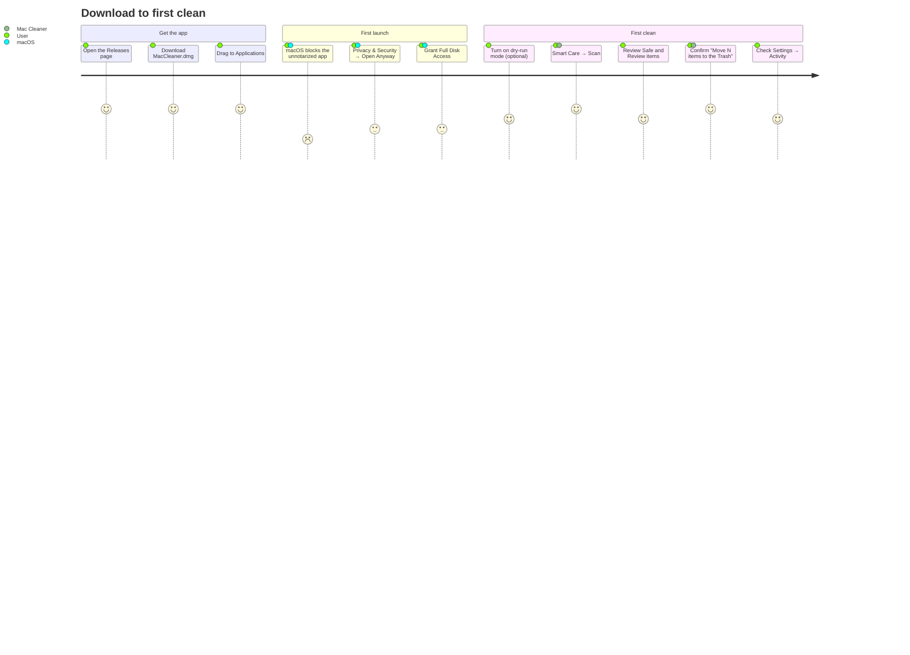
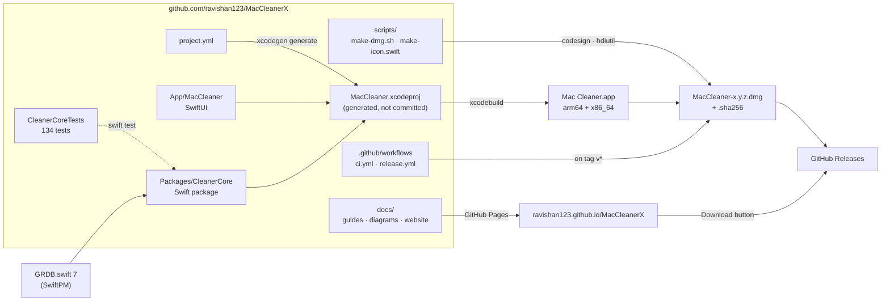

# Diagrams

Every diagram in the project, in one place. They're written in [Mermaid](https://mermaid.js.org), so GitHub draws them and they're edited as plain text alongside the code.

## Index

| Diagram | Type | Where |
|---|---|---|
| User journey: download to first clean | Flowchart | [below](#user-journey) |
| Repository and dependencies | Flowchart | [below](#repository-and-dependencies) |
| How Mac Cleaner keeps your files safe | Flowchart | [README](../README.md#how-it-keeps-your-files-safe) |
| How it's built (overview) | Component | [README](../README.md#how-its-built) |
| Use cases | Use-case | [ARCHITECTURE §1](ARCHITECTURE.md#1-use-cases) |
| System architecture (layers) | Component | [ARCHITECTURE §2](ARCHITECTURE.md#2-system-architecture) |
| Scan, then clean | Sequence | [ARCHITECTURE §3](ARCHITECTURE.md#3-scan-then-clean) |
| Cleanup modules | Class | [ARCHITECTURE §4](ARCHITECTURE.md#4-cleanup-modules) |
| Smart Care concurrency | Flowchart | [ARCHITECTURE §5](ARCHITECTURE.md#5-smart-care-concurrency) |
| App state machine and models | State + flowchart | [ARCHITECTURE §6](ARCHITECTURE.md#6-app-state) |
| Database | Entity-relationship | [ARCHITECTURE §7](ARCHITECTURE.md#7-database) |
| Build and deployment | Deployment | [ARCHITECTURE §8](ARCHITECTURE.md#8-build-and-deployment) |
| The removal pipeline | Flowchart | [SAFETY](SAFETY.md#the-removal-pipeline) |
| SafetyGuard path checks | Decision tree | [SAFETY](SAFETY.md#safetyguard-the-path-allowlist) |
| AppBundleGuard | Decision tree | [SAFETY](SAFETY.md#appbundleguard-the-one-exception-for-applications) |
| First launch ("Open Anyway") | Flowchart | [USER_GUIDE](USER_GUIDE.md#first-launch-open-anyway) |
| Adding a cleanup category | Flowchart | [DEVELOPMENT](DEVELOPMENT.md#adding-a-cleanup-category) |
| Release pipeline | Flowchart | [RELEASING](RELEASING.md) |

## User journey

From finding Mac Cleaner to the first cleanup.

## Repository and dependencies

## Editing diagrams

- Preview while editing: the [Mermaid live editor](https://mermaid.live), or VS Code with a Mermaid extension.
- Keep labels short, and use ` ` for line breaks.
- When code changes a flow shown here (a new module, a new safety rule), update the diagram in the same pull request.
