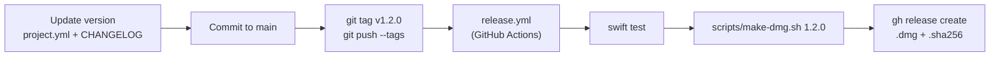

# Releasing

Mac Cleaner ships as a universal (Apple silicon + Intel), **ad-hoc signed** `.dmg` on GitHub Releases. It isn't notarized, which requires a paid Apple Developer account, so users follow the "Open Anyway" steps on first launch.



## Versioning

[Semantic versioning](https://semver.org): `MAJOR.MINOR.PATCH`.
- PATCH: fixes.
- MINOR: new features or cleanup categories.
- MAJOR: changes to safety behaviour or data format.

## Steps

1. Set `MARKETING_VERSION` in `project.yml` and bump `CURRENT_PROJECT_VERSION`.
2. Move the **Unreleased** notes in `CHANGELOG.md` under the new version and date.
3. Run the tests and build locally:
   ```sh
   swift test --package-path Packages/CleanerCore
   scripts/make-dmg.sh 1.2.0
   ```
4. Install the `.dmg` on a clean Mac (or a new user account) and check the first-launch flow, Full Disk Access and a dry-run cleanup.
5. Commit, tag and push:
   ```sh
   git commit -am "Release 1.2.0"
   git tag v1.2.0
   git push origin main --tags
   ```
6. The **Release** workflow (`.github/workflows/release.yml`) tests, builds and publishes `MacCleaner-1.2.0.dmg` and `.sha256` to GitHub Releases. The release notes are that version's section of `CHANGELOG.md` plus the install steps in `docs/release-footer.md`.
7. The [website](https://ravishan123.github.io/MacCleanerX/) picks up the new release by itself: its Download button asks the GitHub API for the latest `.dmg`.

### Publishing a locally built .dmg instead

```sh
scripts/make-dmg.sh 1.2.0
gh release create v1.2.0 build/MacCleaner-1.2.0.dmg build/MacCleaner-1.2.0.dmg.sha256 \
  --title "Mac Cleaner 1.2.0" --notes-file notes.md   # changelog section + docs/release-footer.md
```

## What make-dmg.sh does

1. `xcodegen generate`
2. `xcodebuild` Release with `ARCHS="arm64 x86_64"`
3. `codesign --force --deep --sign - --options runtime` (ad-hoc, hardened runtime), then `codesign --verify --deep --strict`
4. Stages `Mac Cleaner.app` plus an `Applications` link in `build/dmg-stage`, and runs `hdiutil create -format UDZO`
5. Writes `build/MacCleaner-<version>.dmg.sha256`

## Website

`docs/index.html` is served by GitHub Pages (Settings → Pages → *Deploy from a branch*, `main`, `/docs`). `docs/.nojekyll` makes Pages serve the files as they are.

## Notarization (optional, later)

With an Apple Developer ID:
1. Sign with the Developer ID certificate instead of `-`.
2. `xcrun notarytool submit … --wait`, then `xcrun stapler staple`.

Users would then no longer need "Open Anyway", and Full Disk Access would survive updates (stable signature).
