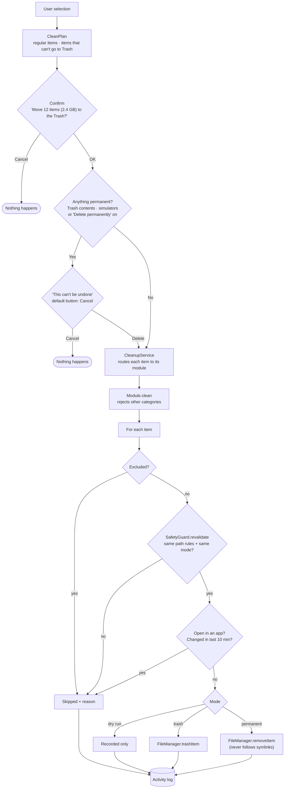
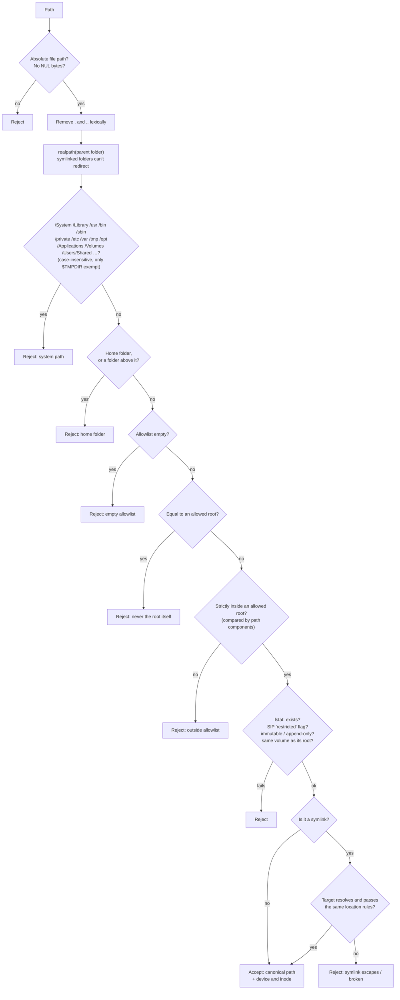
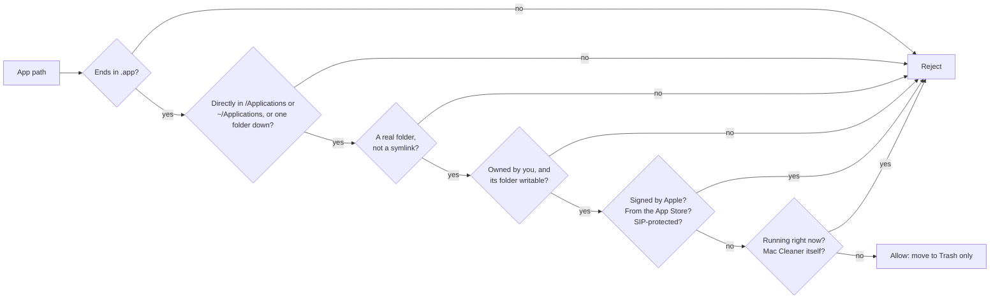

# Safety design

Mac Cleaner deletes files, so safety is its most important feature. This document explains every rule, where it is enforced in code and how it is tested. If you find a way around any of these rules, please report it privately (see [SECURITY.md](../SECURITY.md)).

## Principles

1. **Scanning never changes anything.** Modules only list, `stat` and read files.
2. **Nothing is removed without explicit confirmation**, showing the exact number of items and the space.
3. **Trash first.** Permanent deletion is opt-in, off on every launch, and always asks twice.
4. **Only your own files.** No administrator rights, no privileged helper, and system locations are always blocked.
5. **Check again right before acting.** Something that changed after the scan is refused.
6. **Every action is logged**, including dry runs and skipped items.

## The removal pipeline

Every removal, from any screen, follows this path:

## SafetyGuard: the path allowlist

`Packages/CleanerCore/Sources/CleanerCore/Safety/SafetyGuard.swift`

Each module creates a `SafetyGuard` with the folders it may clean inside, for example `~/Library/Caches`. Every candidate path goes through `validate` when it is scanned and through `revalidate` right before removal.

Also enforced:
- **Allowed roots must be inside your home folder or your own `$TMPDIR`.** A misconfigured root such as `/`, `/Users` or `/usr/local` is dropped when the guard is created.
- **Callers act on the canonical path the guard returns,** never on the raw input.
- **`revalidate` also compares device and inode,** so a file replaced after the scan (by a symlink or a different file) is refused.

## AppBundleGuard: the one exception for /Applications

`Packages/CleanerCore/Sources/CleanerCore/Apps/AppBundleGuard.swift`

`/Applications` is on SafetyGuard's blocked list. The uninstaller uses a separate guard that allows exactly one action: **moving a whole `.app` bundle to the Trash.**

Permanent deletion of an app is always refused, even if requested.

## Skipped items

| Reason | Shown as | Can be checked? |
|---|---|---|
| Open in any of your apps (libproc snapshot of open files and working folders) | **In use** | No |
| The item or anything inside it changed in the last 10 minutes | **Recent** | No |
| macOS blocks reading the folder without Full Disk Access | **No access** | No |
| On your exclusion list | Not shown | — |

## Risk labels

- **Safe:** rebuilt automatically or downloaded again (caches, logs, build products). Pre-checked.
- **Review:** might matter to you (Trash, Mail attachments, archives, iOS backups, large files, duplicates, app data). Never pre-checked.

## Special cases

| Case | Rule |
|---|---|
| Emptying the Trash | Can't go to the Trash, so it always needs the permanent-deletion confirmation. |
| `xcrun simctl delete unavailable` | A command, not a path. Previewed with `simctl list`, runs only in permanent mode, not in dry run. |
| Duplicates | You can't select every copy. Before removing, Mac Cleaner re-hashes a copy that stays (SHA-256); if none remains intact, the whole set is refused. |
| Duplicates (clones, hard links) | Hard links are the same file, not duplicates. APFS clones are shown, but removing one frees ~0 bytes. |
| iCloud, Photos and Messages data | Photos and Music libraries are never offered. iCloud, background-download and account caches are never offered. |
| Shared app containers | Skipped while another app from the same developer is installed. |
| External commands | Only `/usr/bin/xcrun`, `/usr/bin/codesign` and `/usr/sbin/spctl` can run, each with a 30-second timeout. |

## How it is tested

- **131 Swift Testing tests** in `Packages/CleanerCore/Tests`. They only touch throwaway folders under `$TMPDIR` and use a **fake Trash**. `ModuleContext` has no default file operations, so a test can't reach the real Trash by accident.
- **SafetyGuard tests** cover path traversal, symlink escapes (absolute, relative, through a symlinked parent, to `/`, `/System`, `/Library` and the home folder), the home folder and its parents, `/System`, `/Library`, other system paths, an empty or invalid allowlist, SIP flags, and files swapped after the scan.
- **"Scan changes nothing":** these tests snapshot the fixture tree before and after each scan.
- **Mutation checks:** each key rule was disabled on purpose to confirm a test fails. That was done for symlink targets, revalidation, the 10-minute rule, hard-link accounting, the last-copy rule, the running-app rule and app permanent deletion.

## Honest wording

- The malware check says **"No known threats found"**, never "your Mac is safe".
- Sizes are what you'd actually get back. They can be lower than Finder's numbers, never higher.
