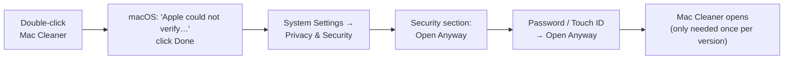

<p align="center">
  <picture>
    <source media="(prefers-color-scheme: dark)" srcset="images/banner-dark.svg">
    
  </picture>
</p>

# User guide

- [Install](#install)
- [First launch ("Open Anyway")](#first-launch-open-anyway)
- [Full Disk Access](#full-disk-access)
- [Try it safely first](#try-it-safely-first)
- [Smart Care](#smart-care)
- [Cleanup](#cleanup)
- [Storage](#storage)
- [Large & old files](#large--old-files)
- [Duplicates](#duplicates)
- [Uninstaller](#uninstaller)
- [Settings](#settings)
- [Keyboard shortcuts](#keyboard-shortcuts)
- [FAQ](#faq)
- [Uninstall Mac Cleaner](#uninstall-mac-cleaner)

## Install

1. Go to **[Releases](https://github.com/ravishan123/MacCleanerX/releases/latest)** and download `MacCleaner-<version>.dmg`. Optionally also download `MacCleaner-<version>.dmg.sha256`.
2. Optional: check the download hasn't been changed. In Terminal, in your Downloads folder:
   ```sh
   shasum -a 256 -c MacCleaner-<version>.dmg.sha256
   ```
   It should print `MacCleaner-<version>.dmg: OK`.
3. Open the `.dmg` and drag **Mac Cleaner** onto **Applications**.
4. Eject the disk image.

Requirements: macOS 14 Sonoma or later, Apple silicon or Intel.

## First launch ("Open Anyway")

Mac Cleaner is free and isn't notarized by Apple, so macOS blocks it the first time.



1. Double-click **Mac Cleaner** in Applications. macOS says it can't verify the app. Click **Done**.
2. Open **System Settings → Privacy & Security**.
3. Scroll to **Security**. Next to *"Mac Cleaner" was blocked to protect your Mac*, click **Open Anyway**.
4. Enter your password or use Touch ID, then click **Open Anyway** again.

> On macOS 14 you can also right-click the app, choose **Open**, then click **Open** in the dialog.

## Full Disk Access

Without it, macOS hides the Trash, Mail attachments, iOS backups and some caches from every app. Mac Cleaner still works, but those show **No access**.

1. In Mac Cleaner's welcome screen (or **Settings → General**), click **Open System Settings**. Or go to **System Settings → Privacy & Security → Full Disk Access** yourself.
2. Turn on **Mac Cleaner**. If it isn't listed, click **+**, choose **Mac Cleaner** in Applications, then turn it on.
3. Quit and reopen Mac Cleaner. The status at the bottom of Smart Care shows **Full Disk Access: Granted**.

After updating to a new version, macOS may forget this. Turn Mac Cleaner off and on again in the same list.

## Try it safely first

Turn on **Settings → General → Dry-run mode**. Every cleanup then only records what *would* be removed in **Settings → Activity**, and nothing on your Mac changes. Turn it off when you're comfortable.

## Smart Care

One scan for everything.

1. Choose what to check: **System junk**, **Malware**, **Performance**.
2. Click the big **Scan** circle. The ring of dots fills as each check finishes. **Stop** cancels it.
3. The results show three numbers (junk you can remove, threats, performance issues) and a list of **recommended actions**:
   - **Safe** actions are pre-checked.
   - **Review** actions are not. Read them first.
   - Actions without a checkbox (startup items, memory, disk space) open the right place: Finder, Activity Monitor or System Settings.
4. Click **Clean up**. A dialog shows exactly how many items and how much space. Confirm to move them to the Trash.
5. **Review details** opens the Cleanup screen with everything Smart Care found.

The malware check looks for warning signs in startup items and app signatures. "No known threats found" means none of those signs were found; it can't promise there's no malware.

## Cleanup

1. Click **Scan** (or **Rescan**, ⌘R).
2. The left column lists 12 categories with their sizes. The circle next to each checks or unchecks the whole category.
3. Click a category to see its items, grouped by app. Check or uncheck items or whole groups.
4. Items marked **In use** or **Recent** are skipped and can't be checked. Try again later.
5. Right-click any item to **Show in Finder**, **Copy Path** or **Never Clean This Item** (adds it to your exclusions).
6. Click **Move to Trash** and confirm.

**Delete permanently** (the switch in the bottom bar) skips the Trash. It's off every time Mac Cleaner starts, and asks you twice. Emptying the Trash and deleting old simulators are always permanent, so they always get the second question.

## Storage

Click **Measure** to see how your disk is used. It reads your home folder and Applications; this can take a minute.

- The grid of dots is your whole disk: **black** is used, **grey** is free, and **red** is the category you selected.
- The list shows each category's size and share. "System & other" is macOS itself, other users, snapshots and anything Mac Cleaner can't read.
- Select a category to see its largest items. The arrow button shows an item in Finder. The button at the top takes you to the tool that can clean that category.

Storage only measures; it never removes anything.

## Large & old files

Finds big files, and files you haven't opened in a while, in **Documents, Downloads, Desktop, Movies, Music and Pictures**.

1. Choose **Larger than** (10 MB – 1 GB) and **Not opened in** (off, 6 months, 1 year, 2 years).
2. Click **Scan**.
3. Results are grouped by kind (Videos, Archives…). Nothing is pre-checked; check what you no longer need.
4. **Move to Trash** and confirm.

Your Photos and Music libraries are never listed.

## Duplicates

Finds exact copies (1 MB or more) in the same personal folders. Files are compared byte for byte.

- Each set shows all copies with their dates.
- **Select copies** checks every copy except the oldest in each set.
- You can't check every copy of a file. The last one is marked **Keeps**.
- Before removing, Mac Cleaner checks again that an identical copy still exists. If not, nothing in that set is removed.

## Uninstaller

**Installed** tab:
1. Choose an app on the left (search at the top).
2. The right side shows the app and every file it left in `~/Library`: settings, caches, containers, saved state, startup items.
   - The app and **Safe** files are pre-checked.
   - **Review** files might contain your documents or settings, so they aren't pre-checked.
3. Click **Uninstall** and confirm. The app and the checked files go to the Trash.

Apps with a 🔒 can't be removed by Mac Cleaner, and the reason is shown: part of macOS, from the App Store (remove those from Launchpad or Finder), currently open (quit it first), or installed for all users.

**Leftovers** tab: **Scan** finds settings and support files named after apps that are no longer installed. Everything is Review; check only what you recognise.

## Settings

| Section | What's there |
|---|---|
| **General** | Dry-run mode, the default action, Full Disk Access status and buttons, the welcome screen |
| **Exclusions** | Files and folders Mac Cleaner never offers or removes. **Add…** or right-click an item in Cleanup. |
| **Activity** | Everything moved, deleted, simulated or skipped, with the reason. **Clear…** removes the history only. |
| **About** | Version, license and the use-at-your-own-risk notice |

## Keyboard shortcuts

| Keys | Action |
|---|---|
| ⌘1 / ⌘2 | Smart Care / Cleanup |
| ⌘, | Settings |
| ⇧⌘L | Activity log |
| ⌘R | Rescan (Cleanup) |
| Return | Scan (Smart Care), Done (dialogs) |
| Esc | Stop a scan, cancel a dialog |
| ↑ / ↓ | Move through the sidebar or the category list |
| Space | Check or uncheck the selected category |
| Tab | Move between controls (turn on *Keyboard navigation* in System Settings → Keyboard) |

VoiceOver reads every checkbox, size and status. Light and dark mode follow your system setting.

## FAQ

**Is it safe?** It's designed to be careful (see [SAFETY.md](SAFETY.md)), but no cleaner can guarantee that removing a file is harmless. Keep backups, start with dry-run mode, and leave Review items unchecked unless you're sure.

**I removed something by mistake.** Open the **Trash** in the Dock, right-click the item and choose **Put Back**. **Settings → Activity** shows the original path and where it went in the Trash.

**Why are the sizes smaller than Finder shows?** Mac Cleaner shows the space you'd actually get back. Files that share blocks with an APFS clone, or that have hard links elsewhere, free less than their size.

**Why does a category say "No access"?** macOS hides that folder until you grant [Full Disk Access](#full-disk-access).

**Why can't I check some items?** They're open in an app, or changed in the last 10 minutes. Quit the app or wait, then rescan.

**Does it send any data anywhere?** No. Mac Cleaner has no network code, no analytics and no account, and everything it finds stays on your Mac. (When it checks an app's Gatekeeper status, macOS itself may contact Apple, just as it does when you open any app.)

**Does it need my password?** Only macOS asks for it, during "Open Anyway". Mac Cleaner never asks and has no administrator helper.

## Uninstall Mac Cleaner

1. Quit Mac Cleaner and drag it from Applications to the Trash.
2. Optional: remove its data:
   - `~/Library/Application Support/Mac Cleaner/` (activity log, exclusions, scan history)
   - `~/Library/Preferences/io.github.maccleaner.app.plist`
3. Optional: remove it from **System Settings → Privacy & Security → Full Disk Access**.
